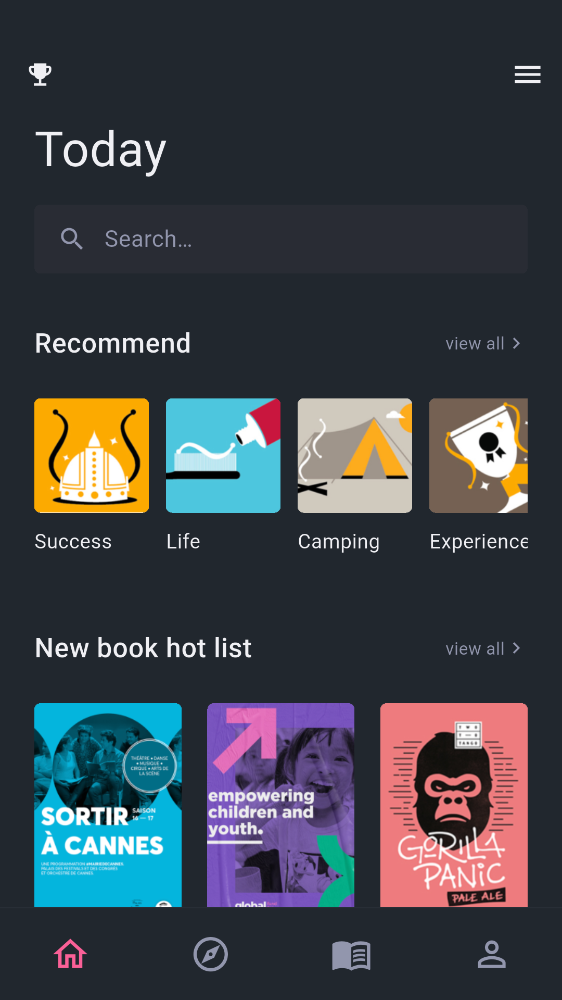

# PostIt Read

根据 Pixso「Read app design」实现的 Flutter 阅读应用。

完整架构、项目结构、22 个页面截图索引与使用方法见 [项目说明](docs/项目说明.md)，测试结果见 [验证记录](docs/验证记录.md)。

[下载演示安装包](artifacts/postit-read-1.0.0.apk) · ARM64 / x86_64 · Release 编译



```powershell
flutter pub get
flutter run -d emulator-5554
```
