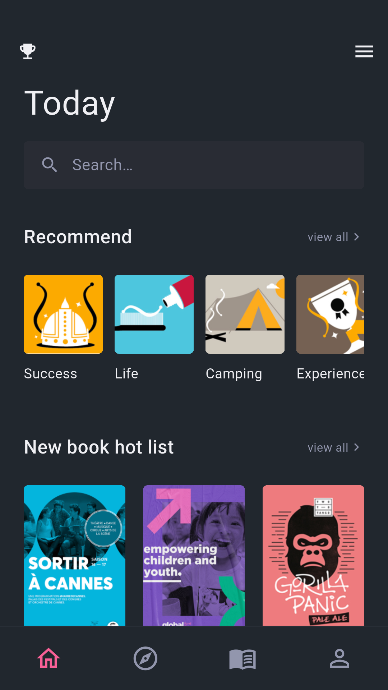
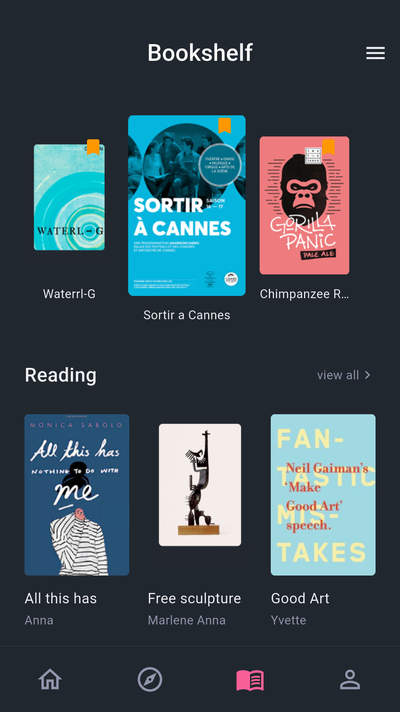
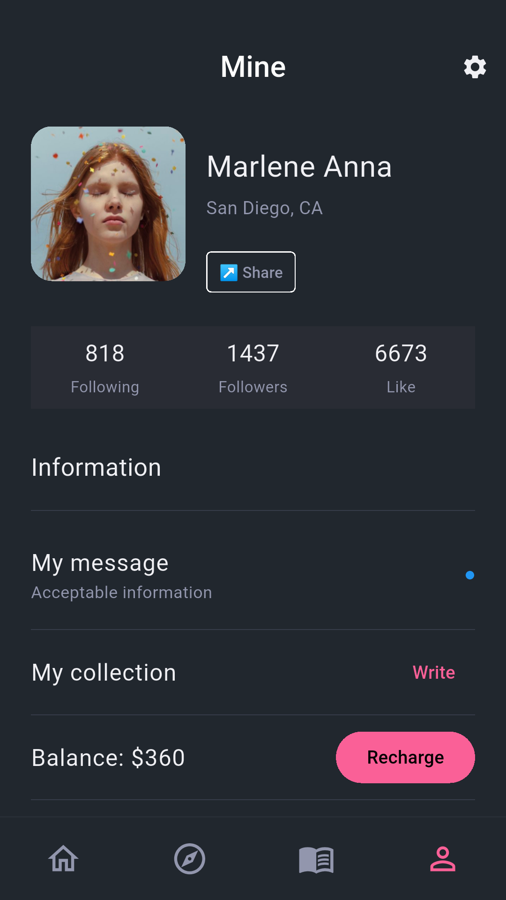
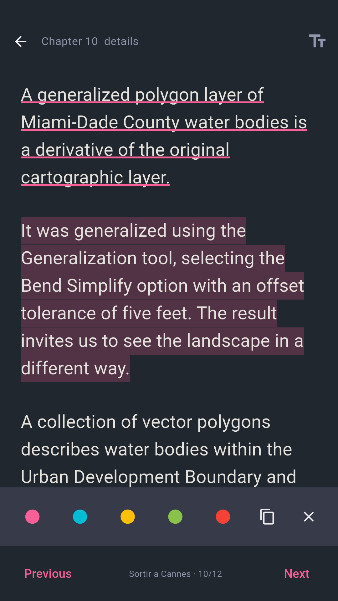
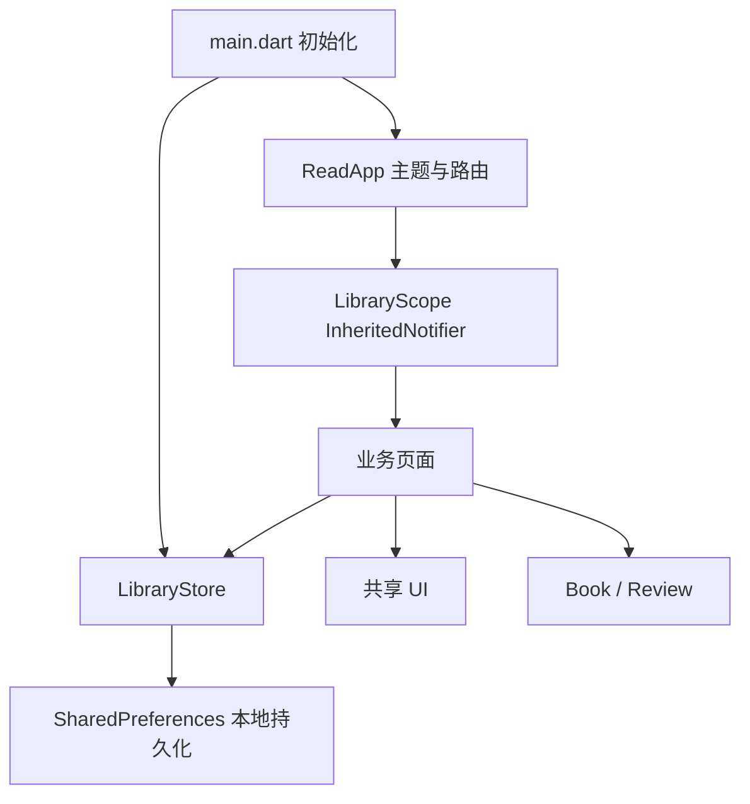

# PostIt Read · Flutter 阅读应用

根据 Pixso「Read app design」实现的离线阅读 App，保留深灰底色、粉色强调、书封插画和页面结构。内容发现、书架、书评、作者关注、阅读标注与演示购买形成完整操作路径。

## 主要界面

下图为既有 Android 11 模拟器上的 Flutter 实际运行截图。

| 首页 | 发现 | 书籍详情 |
| --- | --- | --- |
|  |  |  |

| 书架 | 个人中心 | 阅读标注 |
| --- | --- | --- |
|  |  |  |

## 设计来源

- MCP 读取文件：Read app design；Page 1 共 22 个画板。
- Symbols 为 28 个系统组件，包含状态栏、键盘和开关，不是额外业务页面。
- 全部原始参考图位于 `docs/design/`；`manifest.json` 记录画板 ID、名称、尺寸。
- 20 张书封、头像和分类插画从 Pixso 导出，放在 `assets/images/`，约 1.2 MB。
- 原稿部分黑色文字位于深色背景，阅读页文字横向裁切。实现保留视觉结构，改为浅色正文、自适应换行与纵向滚动。
- 系统状态栏、键盘由 Android 提供，不绘制假系统 UI；图标使用 Flutter Material 图标。

## 运行

环境：Flutter 3.47.7 / Dart 3.13.5，Android 工程使用本机缓存的 Gradle 8.14 / AGP 8.11.1 / Kotlin 2.3.20。构建测试使用 Android Studio JBR 21。

```powershell
flutter pub get
flutter devices
flutter run -d emulator-5554
```

可使用 `flutter run -d chrome` 调试 Web，移动端为主要设计目标。

Android 安装包：[postit-read-1.0.0.apk](../artifacts/postit-read-1.0.0.apk)，包含 ARM64 与 x86_64。采用 Release 编译和本地演示签名，正式发布前需配置自己的签名证书。

```powershell
flutter build apk --release --target-platform android-arm64,android-x64
```

发布构建时保留完整依赖准备步骤，使 Flutter 正确排除测试插件。

## 项目结构

```text
ReadAppDesign/
├── lib/
│   ├── main.dart                 # 初始化偏好存储、系统栏与应用
│   ├── app.dart                  # 主题、命名路由、依赖入口
│   ├── data/books.dart           # Book / Review 与本地展示数据
│   ├── state/library_store.dart  # 用户状态与持久化
│   ├── ui/common.dart            # 页面壳、导航、书封、列表、网格、按钮
│   └── features/
│       ├── catalog.dart          # 首页、发现、搜索、分类、书架、每日推荐
│       ├── book_details.dart     # 详情、入架、分享、评论
│       ├── reader.dart           # 阅读、字号、章节、标注
│       ├── profile.dart          # 个人中心、作者、作者榜、设置
│       └── commerce.dart         # 结算、支付方式、演示充值
├── assets/images/                # 20 张 Pixso 视觉资源
├── artifacts/                    # 演示安装包与校验信息
├── android/                      # Android 宿主与构建配置
├── web/                          # Web 宿主
├── test/library_store_test.dart   # 状态与持久化测试
├── integration_test/app_test.dart # 逐页渲染、截图、用户路径
├── test_driver/integration_test.dart
├── docs/
│   ├── 项目说明.md
│   ├── 验证记录.md
│   ├── design/                   # 22 张设计参考图与 manifest
│   ├── screenshots/              # 22 张运行截图
│   └── verification/             # 发布包启动及持久化检查图
└── pubspec.yaml
```

## 架构



展示层通过 LibraryScope 获取单一 ChangeNotifier 状态对象，LibraryStore 负责用户操作与保存，Book / Review 保存展示数据。唯一直接运行时依赖是 shared_preferences，不引入额外状态管理或路由框架。

| 数据 | 保存方式与行为 |
| --- | --- |
| 书架、喜欢、关注 | 字符串集合；修改后通知界面并保存 |
| 已购、余额 | 集合与数字；检查余额，重复购买不重复扣款 |
| 搜索历史 | 去空、去重、最近优先、最多 10 条 |
| 用户书评 | JSON 字符串列表，提交后显示 |
| 阅读章节、字号 | 全局阅读偏好，调整后保存 |
| 标注 | 保存书籍 ID + 章节；颜色是当前阅读会话状态 |
| Notice | 本地布尔偏好，不请求系统通知权限 |

书籍正文和图片为静态资源，不写入用户存储。后续可将全局章节扩展为 bookId → chapter，以实现每本书独立进度。

## 页面对应与完整截图

| Pixso 画板 | 路由 / 状态 | 截图 |
| --- | --- | --- |
| Home | /home | [01 首页](screenshots/01-home.png) |
| Home-long | /home 向下滚动 | [02 首页下半部分](screenshots/02-home-long.png) |
| Success | /success | [03 书单](screenshots/03-success.png) |
| Fine-1 | /find | [04 聚焦发现](screenshots/04-find-focus.png) |
| Find-2 | /find-grid | [05 网格发现](screenshots/05-find-grid.png) |
| Search for | /search | [06 搜索](screenshots/06-search.png) |
| Book details | /book | [07 详情](screenshots/07-book-details.png) |
| Book details bookshelf | /library-added / 入架按钮 | [08 入架确认](screenshots/08-library-added.png) |
| Book details-share | /share / 分享按钮 | [09 分享](screenshots/09-book-share.png) |
| Comment | /comments | [10 评论](screenshots/10-comments.png) |
| Bookshelf | /bookshelf | [11 书架](screenshots/11-bookshelf.png) |
| Mine | /mine | [12 个人中心](screenshots/12-mine.png) |
| Category | /category | [13 分类](screenshots/13-category.png) |
| Writer personal information | /author | [14 作者](screenshots/14-author.png) |
| Writer | /writers | [15 作者榜](screenshots/15-writers.png) |
| Settings | /settings | [16 设置](screenshots/16-settings.png) |
| payment | /payment | [17 空支付方式](screenshots/17-payment.png) |
| payment-2 | /cards | [18 示例卡](screenshots/18-payment-cards.png) |
| Buy | /buy | [19 结算](screenshots/19-buy.png) |
| Daily recommendation book | /daily | [20 每日推荐](screenshots/20-daily.png) |
| article | /reader | [21 阅读](screenshots/21-reader.png) |
| article-2 | /reader-highlight / 长按段落 | [22 标注](screenshots/22-reader-highlight.png) |

长首页复用同一个滚动页面，截图为滚动后的区域；发现双布局复用状态组件；分享和入架使用真实面板与弹窗；两张阅读画板复用阅读器。另提供 /purchases 展示本地已购书籍。

## 操作路径

1. 首页 → 分类插画 / 书封 → 书单 / 详情；首页底部可进入每日推荐、作者榜。
2. 发现 → 右上切换聚焦 / 网格 → 点击书封。
3. 搜索 → 输入书名、作者或类别 → 结果；提交后保存历史，垃圾桶清空历史。
4. 详情 → 喜欢 / 入架 → 书架；书架封面直接阅读。
5. Trial reading → 阅读；目录选择章节，Previous / Next 切换章节，右上调整字号。
6. 阅读长按段落 → 标注颜色 / 复制；系统文字选择菜单可复制局部文字。
7. Buy → 本地余额结算 → 阅读；余额不足可选择示例卡充值演示余额。
8. 个人中心 → 作者关注、评论、设置 Notice。
9. 分享面板点击平台 → 复制推荐文字，用户自行粘贴到对应应用。

## 验证与重新截图

```powershell
flutter analyze
flutter test
flutter drive -d emulator-5554 --driver=test_driver/integration_test.dart --target=integration_test/app_test.dart
```

集成测试逐个遍历设计界面，检查渲染异常并保存截图，随后验证搜索 → 详情 → 喜欢 → 入架 → 购买 → 阅读 → 设置的用户路径。测试使用内存偏好数据，不修改正常应用的用户记录。结果见 [验证记录](验证记录.md)。

## 范围与后续接入

应用可离线运行，书籍、评论、作者和阅读正文为演示数据，没有登录服务器、真实支付、分享 SDK 或消息服务。支付卡明确标记为样例卡，不收集真实卡号；充值与购买只影响本地余额。作者卡片共用示例作者详情；分类使用本地书籍进行不同排列。标注以段落和章节为单位。

可将 books 常量替换为 Repository，接入真实书籍与账户 API，并将阅读进度改为每本书独立数据。页面与共享组件可以保留。

## 精简策略

复用已运行的 emulator-5554，不新建虚拟设备。资源本地化，不引入额外字体、网络图片和 UI 框架。交付保留源码、测试、设计来源、运行截图和一份安装包；项目构建临时文件可重新生成。
